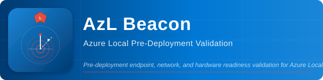

# AzL Beacon



**Pre-deployment endpoint, network and Arc readiness validation for Azure Local 12.2609 (latest).**

When deploying Azure Local there are scenarios where no existing systems are present on the management or compute VLANs: no jump host,
no reachable domain controller, no way to plug in a laptop on the right network. You need to know the network is functional *before* the
deployment starts, not discover firewall gaps or DNS failures halfway through the deployment wizard.

AzL Beacon boots from BMC virtual media or a USB drive on the bare hardware (no installed OS, no domain join, no licensing) and
validates the dependencies Microsoft documents for Azure Local. If it passes, you can deploy with confidence; if it fails, you know what to fix first.

There is deliberately **no drive check**: Beacon validates the network, identity and Azure side, not node storage.

---

## What it validates

| Path | Checks |
|---|---|
| Active Directory | Network and time, DNS, AD ports (TCP and UDP, SRV), region endpoint sweep, Environment Checker |
| Local Identity (AD-less) | Network and time, DNS, region endpoint sweep incl. Key Vault, Environment Checker |
| Networking and Firewall | Network and time, DNS, region endpoint sweep (proxy and Arc gateway aware), public-IP and HTTPS-inspection checks, Environment Checker |
| Arc readiness | Device-code sign-in, resource providers, resource group, Arc roles, existing Arc machines |

Details: [Validation overview](validation/index.md), [Endpoint list](reference/endpoints.md), [Arc readiness](validation/arc-readiness.md).

---

## Hardware support

Dell AX 16G NIC drivers (Dell SBE 5.0.2603.1641) are bundled; other hardware uses `-DriverPath` ([drivers](drivers/dell-ax.md#other-oems)).

| Vendor | Adapter | Driver | Version |
|---|---|---|---|
| Broadcom | NetXtreme-E 57400/57500 (bnxt) | `bnxtnd` | 236.1.152.0 |
| Broadcom | NetXtreme 5720 (1GbE LOM) | `b57nd60a` | 221.0.8.0 |
| Intel | E810 800-series | `icea` | 1.17.73.0 |
| Intel | E823 800-series | `scea` | 1.16.58.0 |
| Mellanox/NVIDIA | ConnectX (mlx5/WinOF-2) | `mlx5` | 24.4.26429.0 |

---

## Quick start

```powershell
git clone https://github.com/AzureLocal/azurelocal-beacon
cd azurelocal-beacon
# Windows ADK + WinPE add-on installed, elevated PowerShell 7.4+
.\src\Build-WinPEImage.ps1
```

Boot `src/output/azl-beacon-<version>-<date>.iso` from virtual media or USB. First build? Follow
[Build and first-boot verification](getting-started/verify-build.md). See a full run in the [Walkthrough](getting-started/walkthrough.md).

---

## Validation lifecycle

| Stage | When | Tool |
|---|---|---|
| **1 - Pre-OS** | Before OS install, booting from the Beacon ISO | AzL Beacon (this tool) |
| 2 - Post-OS | After OS install, before Arc registration | AzStackHci.EnvironmentChecker on each node |
| 3 - Pre-deploy | After Arc registration | Azure portal environment checker |
| 4 - Deployment | During the portal wizard | Built-in deployment validation |
| 5 - Post-deploy | After deployment completes | Operational health checks |

---

## Project

- **Organization:** [AzureLocal](https://github.com/AzureLocal)
- **Repository:** [azurelocal-beacon](https://github.com/AzureLocal/azurelocal-beacon)
- **Releases and changes:** [CHANGELOG](https://github.com/AzureLocal/azurelocal-beacon/blob/main/CHANGELOG.md)
